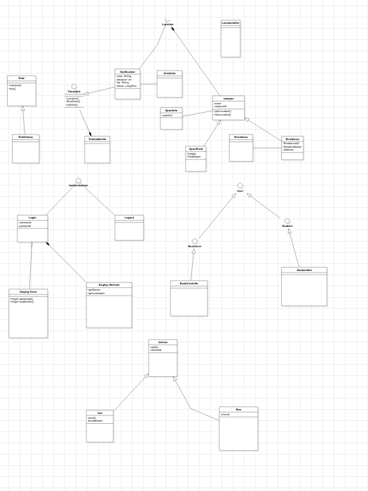

# BusTech - Student Shuttle Management System

## Overview

**BusTech** is an innovative, comprehensive bus management application designed to streamline shuttle operations at CPUT (Cape Peninsula University of Technology). The system enables students, drivers, and management to efficiently coordinate daily shuttle services with real-time updates and digital record-keeping.

## Purpose

BusTech helps students and bus drivers fulfill their daily duties with ease by providing:
- **One-click ride recording** for bus drivers
- **Real-time notifications** to students before buses arrive
- **Digital logbooks** for management oversight
- **Access control** for authorized users only

## Key Features

### For Bus Drivers
- Sign-in system with instant access
- One-click ride recording and logging
- Digital trip management
- Complete journey history tracking

### For Students
- Real-time notifications (10 minutes before bus arrival at shuttle points)
- Easy shuttle booking and access
- Priority access for CPUT students
- Token-based access for non-CPUT users

### For Management
- Complete driver logbooks and records
- Bus fleet management and tracking
- Route and vehicle monitoring
- Ride status and analytics
- Student and driver profile management

## License

Specify your license here

## Version

**Current Version**: 1.0.0  
**Last Updated**: March 15, 2026  
**Status**: Phase 4 complete, ready for Phase 5

